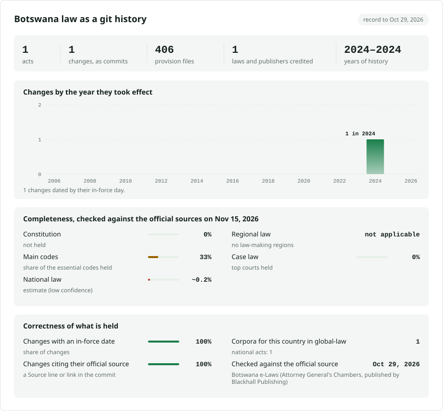

# Botswana: law history in git

<picture>
<source media="(prefers-color-scheme: dark)" srcset="data/effort-dark.svg">

</picture>

The law of Botswana as a git history: one file per section, one commit per version on the day it took effect, and the law that made each change as the commit's author. `git blame` names the law behind every paragraph; `git log` lists every change to a section; picking a date gives the text in force that day.

Part of [lexifina/global-law](https://github.com/lexifina/global-law), one git history for every country's law: this is Botswana's national law, which global-law reads at `botswana/national/acts/`.

**What is in it now:** the Constitution of Botswana (3 versions, 2019 to today's text) and 346 consolidated Acts (315 with a chapter number in `laws/`, 31 newer Acts in `acts/`), 13,683 sections and schedules in all, as the Attorney General's Chambers publishes them on Botswana e-Laws; the Penal Code has 2 versions. See [`STRUCTURE.md`](STRUCTURE.md) for the layout and how each version is dated.

Each act has its own folder, one file per section: `laws/cap-08.01-penal-code/s-202.md` is section 202 of the Penal Code, murder.

The text is in English, the language Botswana's laws are published in, as Botswana e-Laws prints it.

## Questions as git commands

| Question | Command |
| --- | --- |
| Every change to section 202 of the Penal Code | `git log --follow -p --word-diff -- laws/cap-08.01-penal-code/s-202.md` |
| Which law wrote each line of section 202? | `git blame laws/cap-08.01-penal-code/s-202.md` |
| Every version of the Penal Code, with the day each took effect | `git log --format="%h %(trailers:key=In-force,valueonly,separator=) %an" -- laws/cap-08.01-penal-code ':!*/README.md'` |
| Section 202 as in force on 1 January 2025 | `python tools/on.py 2025-01-01 laws/cap-08.01-penal-code s-202` |

`git log -p --word-diff -- constitution/s-068.md` shows what Act 1 of 2021 changed in section 68 of the Constitution.

**Outside git**, we also host this record publicly, for free:

- **[Ask Claude about Botswana law](https://global-law.lexifina.com/v1/try_claude?country=botswana)**: opens Claude with a first question ready.
- **[Ask ChatGPT](https://global-law.lexifina.com/v1/try_chatgpt?country=botswana)**: the same question in ChatGPT.
- **[Search Botswana law on our site](https://lexifina.com/law?country=botswana&q=murder)**: a search for "murder", with each provision's text and its versions, no account needed.
- **[Developer REST API](https://global-law.lexifina.com/v1/search_law?query=murder&jurisdiction=botswana)**: the same search as JSON, with no key. See the [documentation here](https://lexifina.com/api/global-law).

Both assistants read the record through the free Global law connector (MCP, `https://global-law.lexifina.com/mcp`); the first time, the chat gives you the link that adds it. Ask in English.

**Host it yourself easily.** All it takes is git and Python, and the tools run on your machine:

```sh
git clone --depth 1 https://github.com/lexifina/global-law && cd global-law
python3 tools/countries.py add botswana/national/acts
python3 tools/law.py show 2026-01-01 botswana/national/acts/laws/cap-08.01-penal-code/s-202.md
```

Opened in Claude Code, Cursor, VS Code or Codex, the clone also starts a local MCP server with the same tools ([MCP.md](https://github.com/lexifina/global-law/blob/main/MCP.md)).

## Dates

Each commit is dated at noon, Africa/Gaborone, on the day the version took effect, and carries it in its `In-force:` trailer; `Date-basis:` says where the day comes from:

- `commencement`: the page's own "Date of Commencement", when it is no earlier than the year of the last Act in the page's amendment list (for example the Public Service Act, 2 September 2026);
- `publisher-revision`: otherwise, the day the Attorney General's Chambers last revised the page on e-Laws (19 October 2026 for most), when the consolidated text was in force at the latest; the page does not give the day its last amendment took effect;
- for the Constitution's 2019 and the Penal Code's 2024 versions, the day the Internet Archive captured the publisher's earlier site.

No date is the day we downloaded anything. Git cannot store a date before 1970, so earlier days are 1 January 1970 plus a second per commit, the real day in `In-force:`.

The oldest version of each act is credited to the publisher, or to the enacting Act when the page gives that Act's own commencement day and lists no later Act. A later change is credited to the law the publisher's own amendment notes name ("[1 of 2021, s. 2(a).]"); a change they do not explain is the publisher's, labelled "unexplained".

## How it is checked

- `tools/check_repo.py` reads every version back from git on the day it took effect and on the day before, and compares it with the corpus: 0 mismatches, and no commit whose trailers git cannot parse (see [`REPRODUCE.md`](REPRODUCE.md)).
- **Today's text:** every act is taken from the Attorney General's Chambers' own e-Laws site (elaws.gov.bw), whose pages are open to all.
- **Credits:** each section credited to a law carries an amendment note naming that law, matching the sections the bulletin says it amends (Act 1 of 2021: "Amends: s 68").
- History is append-only: no merge commits, no commit dates that go backwards, and none after the build.
- [vulnerabilities/](vulnerabilities/): possible drafting mistakes in this law, found by global-law's detectors and checked by hand. Not run yet.

## What it does not show

- **The day each amendment took effect.** Most acts are one consolidated version dated by the publisher's revision, not one commit per amending law.
- **Earlier history.** Every change before an act's oldest version is folded into it; its commit message names them (for the Penal Code, Law 2 of 1964 to S.I. 93 of 2023).
- **Other law.** 5 consolidated acts whose pages do not mark sections (among them the Public Health Act) are not built yet; subsidiary legislation, Acts as enacted, Acts not yet in force ("on notice"), case law and bills are not here yet.
- **Editorial matter.** Amendment and editorial notes are read for credits only, and Part and Chapter headings are left out; each file starts with its section's number and heading.
- **Changes within a line.** Each paragraph is one line, so blame credits a whole paragraph to the law that changed one word of it.

## Sources

| Source | Kind | Past versions | Notes |
| --- | --- | --- | --- |
| [Botswana e-Laws](https://elaws.gov.bw) (Attorney General's Chambers) | Official consolidation | no, today's text only | Every principal Act and the Constitution, open to all, read through the site's public WordPress interface |
| [botswanalaws.com](https://botswanalaws.com), the same publisher's earlier site, through the [Internet Archive](https://web.archive.org/) | Official consolidation, archived | as captured: the Constitution on 2019-05-26, the Penal Code on 2024-12-04 and 2026-03-23 | The full text of each act's oldest version |

## Licence

See [`LICENSE`](LICENSE). The texts are official texts of a legislative nature, which the Copyright and Neighbouring Rights Act (Cap. 68:02), s 6(2)(b), excludes from copyright protection; the e-Laws footer reads "Copyright (c) 2026. AGC, Botswana All rights reserved." and its disclaimer says the electronic versions are not the official or authorised version. Lexifina's own contributions (the arrangement of the history, the commit messages, the tables and the tools) are CC0 1.0.

No AI model wrote, translated or corrected legal text, and none runs when the history is built; the scripts were written by an AI model (see [`REPRODUCE.md`](REPRODUCE.md)).

## Visualisations

- [visualisations/](visualisations/): charts drawn from this repository. Not drawn yet.

## More

From [lexifina/global-law](https://github.com/lexifina/global-law):

- [FEATURES.md](https://github.com/lexifina/global-law/blob/main/FEATURES.md): every feature, and what every corpus must support (`git blame`, `law.py`, the MCP tools)
- [FAQ.md](https://github.com/lexifina/global-law/blob/main/FAQ.md): questions and answers · [CONTRIBUTING.md](https://github.com/lexifina/global-law/blob/main/CONTRIBUTING.md): proposing changes · [MCP.md](https://github.com/lexifina/global-law/blob/main/MCP.md): the MCP server · [REPRODUCE.md](https://github.com/lexifina/global-law/blob/main/REPRODUCE.md): how it was built · [CHANGELOG.md](https://github.com/lexifina/global-law/blob/main/CHANGELOG.md)
- [FRESHNESS.md](https://github.com/lexifina/global-law/blob/main/FRESHNESS.md): how current each corpus is · [Monitoring](https://github.com/lexifina/global-law/tree/main/monitoring): whether updates are running · [WATCHING.md](https://github.com/lexifina/global-law/blob/main/WATCHING.md): how each official source is watched for changes
- [performance/](https://github.com/lexifina/global-law/tree/main/performance): how fast the tools are, measured
- [visualisations/](https://github.com/lexifina/global-law/tree/main/visualisations): charts and bridges across the world's law
- [Vulnerabilities](https://github.com/lexifina/global-law/tree/main/vulnerabilities): mistakes in legislation as published
